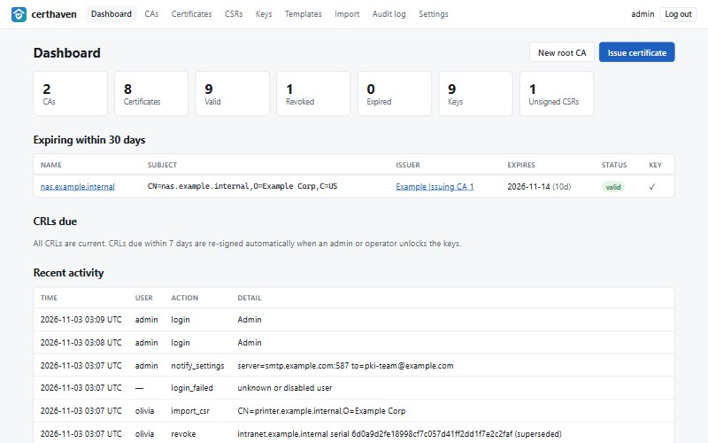
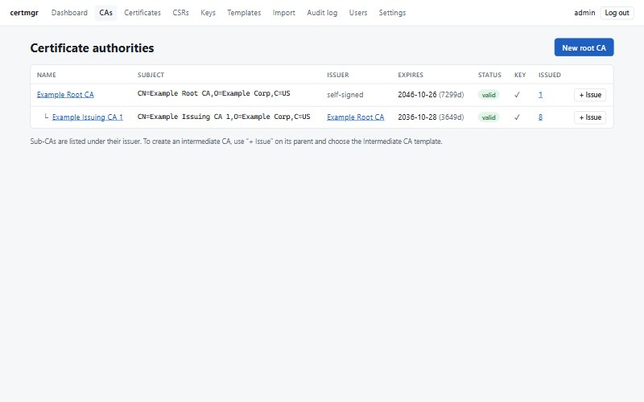
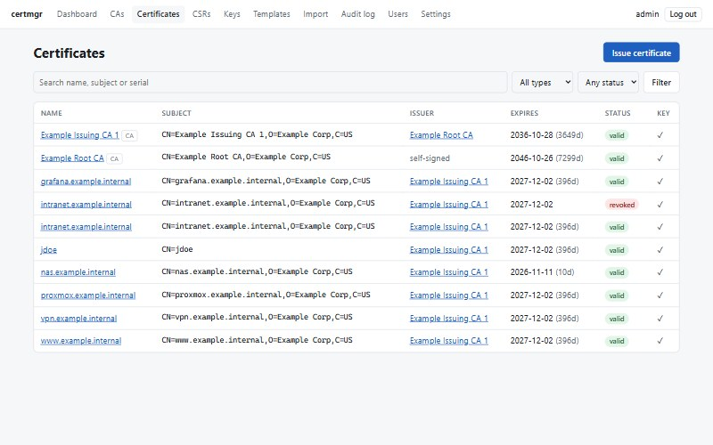
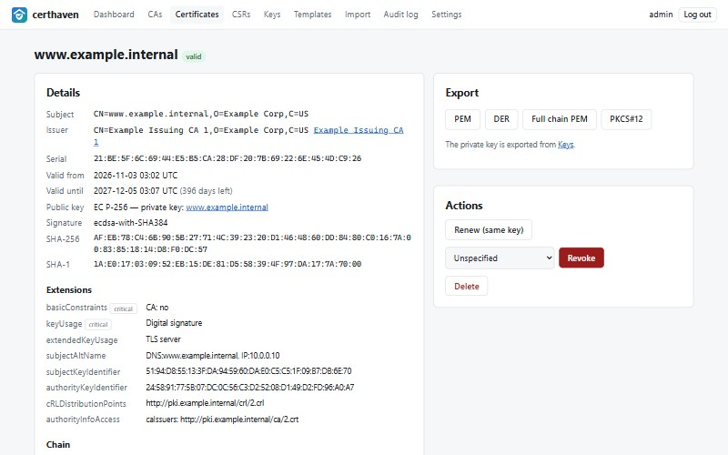
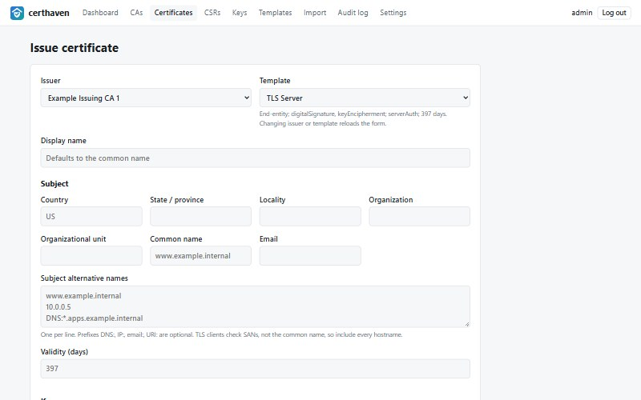
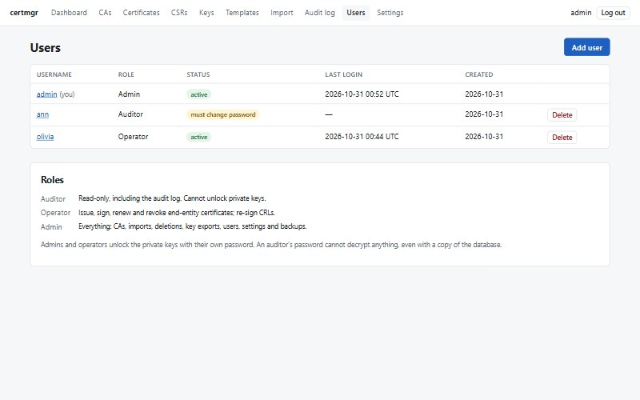
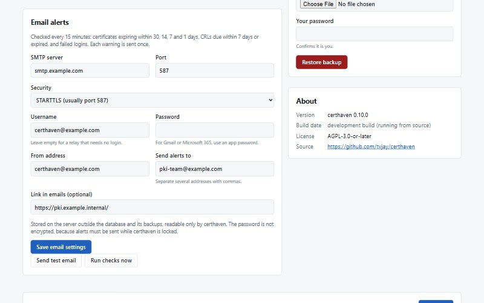
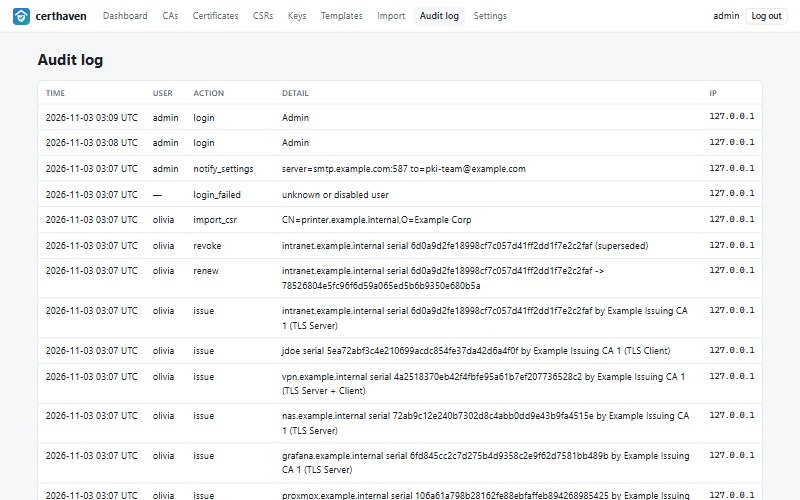

# certmgr

[](https://github.com/tvjay/certmgr/actions/workflows/ci.yml)
[](LICENSE)

**A self-hosted private certificate authority with a web UI.** certmgr builds a CA hierarchy, issues and signs
certificates, revokes them and publishes CRLs, all from a small web app on a Debian server, so a team shares one
CA in the browser instead of passing key files around.

It is built for home labs and internal networks: NAS boxes, hypervisors, dashboards, VPNs, internal APIs and
client certificates, all signed by a CA your devices trust.

> **Status:** 0.x. It runs a small production CA, but expect changes between versions; read the
> [changelog](CHANGELOG.md) before upgrading, and keep backups.



## Features

- **CA hierarchy** — create root and intermediate CAs (or import existing ones) and see them in one table,
  each sub-CA listed under the CA that issued it.
- **Issue from templates** — Root CA, Intermediate CA, TLS Server, TLS Client and Server + Client, or your own,
  with key usage, extended key usage, validity and subject defaults. RSA 2048/3072/4096, EC P-256/P-384, Ed25519.
- **Sign CSRs** — paste or upload a CSR, review it, edit its SANs and sign it. The template decides what the
  certificate may do, never the request. You can also create CSRs for keys kept in certmgr.
- **Revocation and CRLs** — revoke with a reason code; the CA's CRL is re-signed straight away and served at a
  public URL that is written into every certificate (CRL distribution point and CA-issuer links).
- **Export and import** — PEM, DER, full chain, PKCS#12; private keys plain or passphrase-protected. Import
  PEM, DER and PKCS#12 bundles in any order: certificates link to their issuers and keys automatically.
- **Users and roles** — Admin, Operator and Auditor, with a full audit log of who did what.
- **Email alerts** — certificates expiring in 30/14/7/1 days, CRLs due or expired, and failed logins, each sent
  once. SMTP is set up in the web UI.
- **Search** — certificates by name, subject or serial, filtered by type and status; private keys by name or
  fingerprint, filtered by algorithm and whether anything uses them.
- **Housekeeping** — renew with the same key, expiry dashboard, one-click database backup, nightly backups.

| | |
|---|---|
|  |  |
| **CAs**, each sub-CA under its issuer, with what each one issued | **Certificates**, searchable, with expiry and status |
|  |  |
| **Certificate detail**: extensions, chain, export, renew, revoke | **Issue** from a template, with hostnames and IPs as SANs |
|  |  |
| **Users** with Admin, Operator and Auditor roles | **Email alerts**, configured in the browser |



## Roles

| Role | Can |
|---|---|
| **Auditor** | View everything, including the audit log; download certificates and CRLs. Cannot unlock private keys. |
| **Operator** | Everything an auditor can, plus issue, sign, renew and revoke end-entity certificates, create CSRs and keys, and re-sign CRLs. |
| **Admin** | Everything: create, renew and revoke CAs; import; delete; export private keys and PKCS#12; manage users, settings and backups. |

Admins add users with a temporary password that must be changed at first login. Every POST action is
admin-only unless it is explicitly granted to a lower role, so new features fail closed.

## Security model

- **Private keys are encrypted at rest.** A random 256-bit data key encrypts every private key in the database
  (AES-256-GCM). Each admin and operator holds a copy of that data key wrapped with a key derived from their
  own password (scrypt, N=2¹⁷). Auditors hold none, so an auditor's password cannot decrypt anything, even with
  a copy of the database.
- **Keys are only in memory while unlocked.** An admin or operator logging in unwraps the data key into the
  memory of the single app process. **Lock keys** (on Settings), the idle timeout or a restart discards it; the next signing
  action asks for a password again. Core dumps are disabled so the key never lands on disk.
- **Public endpoints keep working while locked.** `/crl/<id>.crl` and `/ca/<id>.crt` serve already-signed
  data. CRLs due within 7 days are re-signed whenever an admin or operator unlocks the keys, and the email
  alerts warn you before one expires.
- **Web hardening:** CSRF tokens on every form, `Secure`/`HttpOnly`/`SameSite` cookies, a strict
  Content-Security-Policy, login throttling (per IP in the app and in nginx), at most two password checks at a
  time, sessions that end after 12 hours or when a user's password, role or status changes.
- **Host hardening:** a sandboxed systemd unit with a memory cap, Python libraries from Debian (patched by
  normal security updates), a ufw firewall script and an SSH hardening snippet.

> **If every admin and operator forgets their password, the private keys cannot be recovered.** Keep at least
> two admins, and keep their passwords in a password manager.

## Install

You need a **Debian 13 (trixie)** server, root access, and a DNS name for the server. certmgr ships as a Debian
package that uses Debian's own Python libraries (Flask, SQLAlchemy, cryptography, gunicorn), so their security
fixes arrive with normal system updates. Other distributions are not tested.

Download the `.deb` and its checksum from the [latest release](https://github.com/tvjay/certmgr/releases/latest),
check it, and install it (apt pulls in the dependencies):

```bash
VERSION=0.9.6   # the latest release
wget https://github.com/tvjay/certmgr/releases/download/v$VERSION/certmgr_${VERSION}-1_all.deb{,.sha256}
sha256sum -c certmgr_${VERSION}-1_all.deb.sha256
sudo apt install ./certmgr_${VERSION}-1_all.deb
```

Or build the package yourself from a checkout (see [Development](#development)) and install the result the
same way.

The package creates the `certmgr` system user, keeps data in `/var/lib/certmgr` (mode 0700), creates a temporary
TLS certificate and an nginx site, and starts `certmgr.service` (gunicorn on 127.0.0.1:8000) with the
email-alert and nightly-backup timers. Data, TLS files and your edits to the nginx site are never overwritten by
upgrades. Install `unattended-upgrades` (recommended by the package) so security fixes are applied automatically.

> On a host with IPv6 disabled, certmgr stops Debian's nginx package from enabling its stock site, which
> listens on IPv6 and would fail to start. If nginx was installed and failed before certmgr, run `sudo rm /etc/nginx/sites-enabled/default` and then
> `sudo dpkg --configure -a`.

### After installing

1. Open `https://<server>/` (accept the temporary certificate), create the first admin, and set the **public
   base URL**, for example `http://pki.example.internal`. Use plain `http`: CRL clients do not use TLS, and
   nginx serves only `/crl/` and `/ca/` on port 80 and redirects everything else to HTTPS. The base URL is
   written into every certificate you issue, so choose a stable name before issuing anything.

2. Lock down the host. List the networks allowed to reach SSH and the admin UI:

   ```bash
   sudo bash /usr/share/certmgr/firewall-ufw.sh "192.168.10.0/24"
   sudo install -m 0644 /usr/share/certmgr/sshd-hardening.conf /etc/ssh/sshd_config.d/certmgr-hardening.conf
   sudo sshd -t && sudo systemctl reload ssh
   ```

   Run the firewall script from a console, or from SSH inside one of the networks you list, so it cannot lock
   you out. Port 80 stays open to everyone for CRL downloads.

### First steps

1. **Create a root CA** (or **Import** an existing one with its key).
2. Issue an **Intermediate CA** from it, and issue day-to-day certificates from the intermediate.
3. **Replace the admin UI's temporary certificate:** issue a TLS Server certificate for the server's name,
   download **Full chain PEM** and the key (Keys → Export), then:

   ```bash
   sudo install -m 0644 fullchain.pem /etc/certmgr/tls/server.crt
   sudo install -m 0600 server.key /etc/certmgr/tls/server.key
   sudo nginx -t && sudo systemctl reload nginx
   ```

4. **Trust the root** on your devices: download it from `http://<base URL>/ca/<root id>.crt`.
   Firefox keeps its own list: import the root there too (Settings → Privacy & Security → Certificates).
5. **Install the full chain on every server.** When you put a certificate on a web server, use **Full chain
   PEM**, not the single certificate. Windows browsers fetch a missing intermediate on their own, but Firefox,
   Linux tools, Android and most scripts reject a server that sends only its own certificate.
6. Set up **email alerts** under Settings, press **Send test email**, and add your team under **Users**.

## Operations

```bash
sudo systemctl status certmgr certmgr-notify.timer certmgr-backup.timer
sudo journalctl -u certmgr -f            # app log
sudo journalctl -u certmgr-notify        # email alert runs
```

- **Upgrade:** take a backup (Settings → Download backup), then download the new release's `.deb` and install
  it the same way: `sudo apt install ./certmgr_<version>-1_all.deb`. Data, TLS files and email settings are
  kept; database changes are applied automatically. Upgrading restarts certmgr, which locks the private keys
  until an admin or operator logs in. Settings → About shows the installed version.
- **Restore a backup:** Settings → Backup → **Restore backup** (admins). It replaces everything on the server —
  users, private keys, certificates with their names, settings, audit log — with the backup, after saving the
  current database as `/var/lib/certmgr/pre-restore-<time>.db`. Everyone is logged out; log in with an account
  and password from the backup, which also unlocks its keys. Email settings are not part of backups. This is
  also how to move certmgr to another server. (**Import** is for certificate and key files; it refuses a
  backup.) Without the web UI: stop the service, copy the `.db` file to `/var/lib/certmgr/certmgr.db` (owner
  `certmgr`, mode 0600) and start it again.
- **One worker only:** the unlocked key lives in a single process, so keep gunicorn at `--workers 1`
  (threads are fine).
- **Email settings** are stored in `/var/lib/certmgr/notify.conf` (mode 0600), outside the database and its
  backups. The SMTP password there is not encrypted, because alerts must go out while the keys are locked; use
  an app password or a send-only relay account. Preview what would be sent:

  ```bash
  sudo -u certmgr CERTMGR_DATA_DIR=/var/lib/certmgr flask --app /usr/lib/certmgr/wsgi notify --dry-run
  ```

## Development

```bash
python3 -m venv .venv
.venv/bin/pip install -r requirements-dev.txt
.venv/bin/pytest
CERTMGR_INSECURE_COOKIES=1 CERTMGR_DATA_DIR=./instance .venv/bin/python wsgi.py
```

The dev server listens on http://127.0.0.1:8000. `CERTMGR_INSECURE_COOKIES=1` allows the session cookie over
plain http; never set it in production. The tests cover the crypto, every role's permissions, and end-to-end
flows whose chains are verified with `cryptography`'s X.509 path validator.

`requirements.txt` lists the libraries for development; the package depends on Debian's versions of the same
libraries, which the test suite also passes against.

To build the Debian package on any Debian or Ubuntu machine (needs only `dpkg-deb`), bump `__version__` in
`certmgr/__init__.py`, add an entry to `packaging/debian/changelog`, then:

```bash
bash packaging/build-deb.sh        # writes dist/certmgr_<version>-1_all.deb
```

GitHub Actions runs the tests on every push and pull request. Pushing a tag such as `v0.9.4` builds the
package and publishes it, with its checksum, as a GitHub release.

```
certmgr/
  crypto/       keys, certificates, CSRs, CRLs, import/PKCS#12, vault (key encryption)
  accounts.py   users, password checks and key wrapping
  notify.py     email alerts
  services.py   business logic between models and crypto
  security.py   sessions, roles, CSRF, throttling, headers
  views/        one blueprint per page group
  templates/    Jinja HTML
deploy/         systemd units, nginx site, backup script, ufw and SSH hardening (installed by the package)
packaging/      Debian package: control file, maintainer scripts, build script
tests/          pytest suite
docs/           screenshots
.github/        CI: tests, package build and releases
```

## Contributing

Bug reports and pull requests are welcome. Please run the tests (`pytest`) before opening a pull request, keep
changes focused, and add a line to the `Unreleased` section of [CHANGELOG.md](CHANGELOG.md) for anything a user
would notice.

## Security

certmgr holds the keys to your CA, so please report vulnerabilities privately, as described in
[SECURITY.md](SECURITY.md), rather than in a public issue.

## License

certmgr is free software under the [GNU Affero General Public License v3.0 or later](LICENSE) (AGPL).

The AGPL keeps certmgr open wherever it runs: if you modify it and let other people use your version over a
network, you must offer them its source code. Every page links to the source (the **Source code** link at the
bottom). If you run a modified version, point that link at your own code by changing `SOURCE_URL` in
`certmgr/__init__.py`. Using certmgr unmodified carries no extra obligations.

Built with [Flask](https://flask.palletsprojects.com/), [SQLAlchemy](https://www.sqlalchemy.org/) and
[cryptography](https://cryptography.io/).
